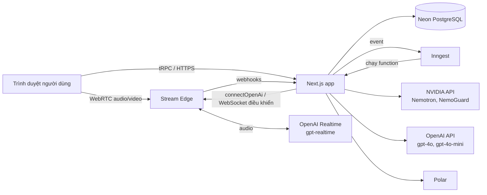
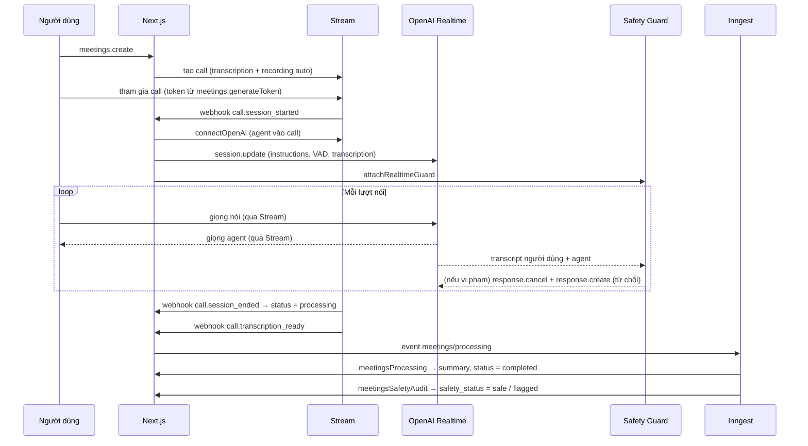
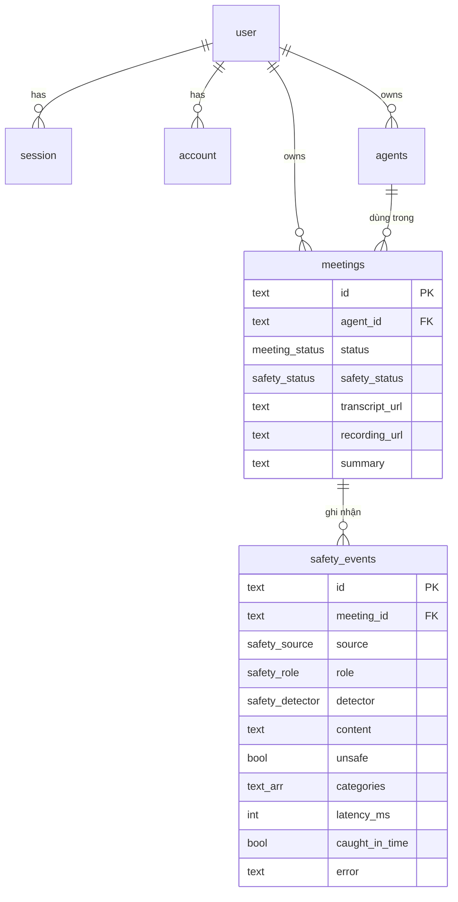

# Kiến trúc tổng quan

> Cập nhật: 18/10/2026

## 1. Hệ thống làm gì

Người dùng tạo **AI agent** (tên + chỉ dẫn hành vi), rồi tạo **cuộc họp video** với agent đó. Trong cuộc gọi, agent nghe và nói trực tiếp bằng OpenAI Realtime (speech-to-speech). Sau cuộc gọi, hệ thống tự tạo transcript, bản ghi âm, bản tóm tắt; người dùng có thể chat hỏi lại agent về nội dung cuộc họp. Gói miễn phí giới hạn số agent/cuộc họp, nâng cấp qua Polar.

Lớp **Safety Guard** (NVIDIA Nemotron + bộ phát hiện jailbreak) giám sát cả trong lúc gọi, trong chat và sau cuộc gọi — xem [safety-guard.md](safety-guard.md).

## 2. Thành phần



| Thành phần | Công nghệ | Vai trò |
|---|---|---|
| Web app | Next.js 15 (App Router), React 19, Tailwind, shadcn/ui | Giao diện + API |
| API nội bộ | tRPC v11 + TanStack Query | Các thao tác agents / meetings / premium |
| Xác thực | better-auth (email/mật khẩu, GitHub, Google) | Phiên đăng nhập lưu ở bảng `session` |
| CSDL | Neon PostgreSQL + Drizzle ORM | Lưu user, agent, meeting, safety events |
| Video / chat | Stream Video SDK, Stream Chat | Cuộc gọi WebRTC, chat sau họp |
| Agent | OpenAI Realtime (qua `connectOpenAi` của Stream) | Nghe – nói trực tiếp trong cuộc gọi |
| Job nền | Inngest | Tóm tắt, kiểm duyệt sau cuộc gọi |
| Thanh toán | Polar (plugin better-auth) | Gói đăng ký, giới hạn free tier |
| Kiểm duyệt | NVIDIA Nemotron Safety Guard, NemoGuard JailbreakDetect, gpt-4o-mini | Safety Guard |

**Điểm quan trọng:** âm thanh cuộc gọi **không đi qua server của mình** — Stream nối trực tiếp với OpenAI. Server chỉ giữ một kết nối WebSocket "điều khiển" để cấu hình agent, nhận sự kiện (transcript, trạng thái câu trả lời) và gửi lệnh (hủy câu trả lời, yêu cầu trả lời).

## 3. Cấu trúc mã nguồn

```
src/
├── app/                  # Chỉ định tuyến + trang mỏng
│   ├── (auth)/ (dashboard)/ call/[meetingId]/
│   └── api/  auth/  trpc/  inngest/  webhook/   ← webhook Stream điều khiển vòng đời cuộc họp
├── modules/<tính năng>/  # agents, meetings, premium, call, ...
│   ├── server/procedures.ts   # tRPC router của tính năng
│   └── ui/views, ui/components, hooks, schemas.ts, params.ts
├── trpc/                 # init.ts: protectedProcedure, premiumProcedure
├── inngest/              # meetingsProcessing (tóm tắt), meetingsSafetyAudit (kiểm duyệt)
├── lib/                  # auth, stream, polar, nemotron, jailbreak, realtime-guard, safety-events
└── db/schema.ts          # toàn bộ bảng
```

## 4. Vòng đời một cuộc họp



Trạng thái cuộc họp (`meetings.status`): `upcoming → active → processing → completed` (hoặc `cancelled`).
Trạng thái an toàn (`meetings.safety_status`): `pending → safe` hoặc `flagged`.

Các webhook Stream xử lý trong `src/app/api/webhook/route.ts`:

| Sự kiện | Xử lý |
|---|---|
| `call.session_started` | status = active; nối agent; cấu hình session; gắn guard |
| `call.session_participant_left` | kết thúc cuộc gọi (**bất kỳ ai rời, kể cả agent**) |
| `call.session_ended` | status = processing |
| `call.transcription_ready` | lưu transcriptUrl, gửi event Inngest |
| `call.recording_ready` | lưu recordingUrl |
| `message.new` | chat sau họp: guard đầu vào → GPT-4o → guard đầu ra → trả lời |

## 5. Cơ sở dữ liệu



Thay đổi schema dùng `npm run db:push` (không có file migration).

## 6. Chạy ở máy local

```bash
npm run dev            # Next.js :3000
npm run dev:webhook    # ngrok → để Stream gửi webhook về máy
npx inngest-cli dev    # Inngest dev server :8288
```

Điều kiện để luồng cuộc gọi chạy ở local:
- Webhook trong Stream Dashboard phải trỏ về URL ngrok (`…/api/webhook`). **Nhớ đổi lại về Vercel sau khi test.**
- `.env` có đủ biến (danh sách trong `CLAUDE.md`), gồm `NVIDIA_API_KEY`.
- Mở trước vài trang để dev server biên dịch xong — trong lúc biên dịch, server bị "khựng" ~10 s.

## 7. Các ràng buộc kỹ thuật cần nhớ

| Ràng buộc | Hậu quả nếu vi phạm |
|---|---|
| `@stream-io/openai-realtime-api` phải ≥ 0.4 (giao thức GA) | Mọi `session.update` lỗi `Missing required parameter: 'session.type'` → agent bị ngắt |
| Luôn truyền `turn_detection` khi `updateSession` | Client mặc định gửi `turn_detection: null` → tắt VAD → agent không bao giờ trả lời |
| `next.config.ts` giữ `serverExternalPackages: ["ws", …]` | `bufferUtil.mask is not a function` → instructions + guard không được nạp |
| Không gửi `response.cancel` khi không có câu trả lời đang chạy; không gửi `response.create` khi câu cũ chưa `response.done` | OpenAI trả `error` → wrapper Stream ngắt agent |
| `inngest` ≥ 3.54 | Inngest dev server chặn đồng bộ (CVE-2026-42047) → không function nào chạy |
| Agent cần process chạy liên tục để giữ WebSocket | Trên Vercel (serverless) agent rời cuộc gọi khi function hết thời gian (~10–15 s) |
