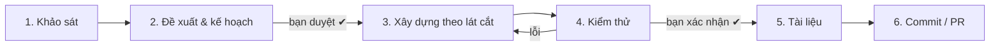

# Quy trình làm việc đề xuất

> Bản đề xuất — bạn duyệt/sửa rồi mình đưa phần cốt lõi vào `CLAUDE.md` để các phiên sau tự tuân theo.

## Nguyên tắc

1. **Chưa hiểu thì chưa code.** Chức năng lớn luôn bắt đầu bằng khảo sát và đo đạc nhỏ.
2. **Bạn duyệt ở các điểm chốt**, mình không tự đi tiếp qua điểm chốt.
3. **Mỗi bước có bằng chứng**: số đo, log, kết quả test — không "chắc là chạy".
4. **Tài liệu đi cùng code**: xong chức năng là tài liệu được cập nhật.
5. Phân biệt rõ **chức năng lớn** và **việc nhỏ** — việc nhỏ không cần đi đủ quy trình.

## Phân loại công việc

| Loại | Ví dụ | Quy trình |
|---|---|---|
| **Lớn** | Tích hợp Nemotron, kill-switch + trang quản trị, triển khai worker | Đủ 6 bước bên dưới |
| **Vừa** | Thêm cột, sửa một luồng, chỉnh prompt | Bước 2 (kế hoạch ngắn trong chat) → 3 → 4 → 6 |
| **Nhỏ** | Sửa lỗi rõ ràng, đổi text, đổi màu | Làm luôn, báo lại |

## 6 bước cho chức năng lớn



### Bước 1 — Khảo sát (mình làm, chỉ đọc, không sửa code)
- Đọc code liên quan, tài liệu chính thức của thư viện/dịch vụ.
- **Thử nghiệm nhỏ** nếu có điểm chưa chắc (như hôm nay: đo độ trễ Nemotron, thử NemoGuard) — bằng script ngoài repo.
- Kết quả: ghi vào tài liệu khảo sát `docs/khao-sat/<tên-chức-năng>.md`: hiện trạng, phương án, đánh đổi, số đo, rủi ro.

### Bước 2 — Đề xuất & kế hoạch → **điểm chốt: bạn duyệt**
- Mình đưa: phương án khuyến nghị + lý do, những gì **không** làm, các bước nhỏ, những việc bạn cần thao tác (key, cấu hình, test).
- Bạn: duyệt / sửa / chọn phương án khác. Các câu hỏi mở được giải quyết ở đây.

### Bước 3 — Xây dựng theo lát cắt (mình làm)
- Chia thành lát nhỏ chạy được độc lập (ví dụ hôm nay: service gọi Nemotron → guard realtime → lưu DB → chat → hậu kiểm).
- Mỗi lát: code → type-check + lint → tự chạy thử được gì thì chạy (script, truy vấn DB).
- Mọi thay đổi trên **một nhánh git riêng** cho chức năng (`feat/<tên>`), tách từ `29-finish` và merge về `29-finish` (xem mục "Quy ước nhánh").
- Có thể thêm công tắc bật/tắt (như `REALTIME_GUARD=off`) để dễ so sánh và rút lui.

### Bước 4 — Kiểm thử (bạn + mình) → **điểm chốt: bạn xác nhận**
- Mình chuẩn bị **kịch bản test**: các bước, câu thử, kết quả kỳ vọng, cần gửi lại log gì.
- Bạn chạy phần cần tương tác thật (cuộc gọi, giao diện), gửi log.
- Mình phân tích log, đối chiếu DB, sửa — lặp lại đến khi đạt.

### Bước 5 — Tài liệu (mình làm)
- Cập nhật tài liệu thiết kế (`docs/<chức-năng>.md`): kiến trúc, quyết định, cấu hình, số liệu, giới hạn.
- Ghi nhật ký phiên (`docs/nhat-ky/`), cập nhật `docs/van-de-mo.md`, `CLAUDE.md` nếu có bẫy kỹ thuật mới.

### Bước 6 — Commit / PR → **điểm chốt: bạn đồng ý**
- Mình đề xuất chia commit + nội dung message; chỉ commit/push khi bạn đồng ý.
- PR vào `main` với mô tả tóm tắt + cách test.

## Quy ước nhánh

- `main`: production. Merge vào `main` là Vercel tự deploy, nên **chỉ merge khi sẵn sàng deploy thật** (sau khi giải quyết A3).
- `29-finish`: nhánh dev tích hợp. Việc nhỏ (tài liệu, sửa lỗi lặt vặt) làm thẳng ở đây.
- `feat/<tên>`: chức năng lớn, tách từ `29-finish`, merge về `29-finish` khi xong. Mỗi nhánh push lên có bản Preview riêng trên Vercel để kiểm tra build.
- Khi `main` có thay đổi (ví dụ bản vá bảo mật) thì merge `main` về `29-finish` sớm để tránh conflict lớn về sau.
- Làm trên nhiều máy: `git pull` trước khi làm, commit và push khi xong.

## Cách bạn giao việc

Mẫu ngắn để bắt đầu một chức năng lớn:

```
Chức năng: <tên>
Mục tiêu: <muốn đạt được gì, cho ai>
Ràng buộc: <hạn chót, không được ảnh hưởng gì, ngân sách API…>
Bắt đầu từ: khảo sát
```

Các câu lệnh điều hướng hữu ích:
- "Dừng ở khảo sát" / "Chỉ lên kế hoạch, chưa code" — mình dừng trước điểm chốt.
- "Ghi lại để bàn sau" — mình đưa vào `docs/van-de-mo.md`.
- "Làm tiếp" — đi tiếp sang bước kế.

## Áp dụng ngay cho dự án

- Nhánh hiện tại `29-finish` đang chứa toàn bộ thay đổi hôm nay **chưa commit** → đề xuất commit theo nhóm (guard, sửa lỗi realtime, nâng phụ thuộc, tài liệu) khi bạn đồng ý.
- Chưa có hạn chót cố định (người dùng sẽ báo khi có). Thứ tự ưu tiên hiện tại: (1) chính sách phân mức, (2) kill-switch và cách ly, (3) `vn_policy`, (4) bộ thử nghiệm + số liệu Chương 3, (5) sửa tài liệu đồ án.
